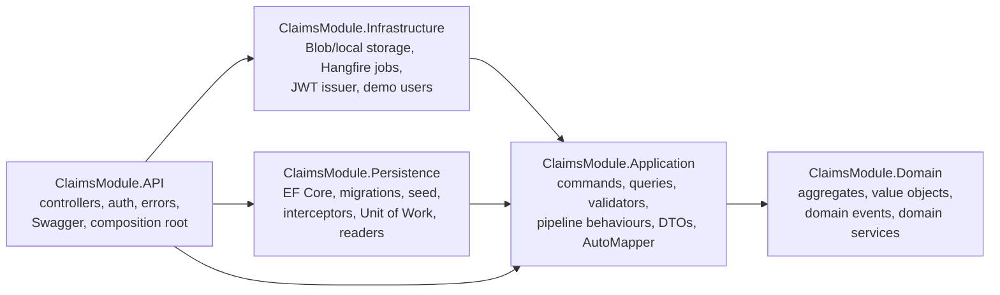
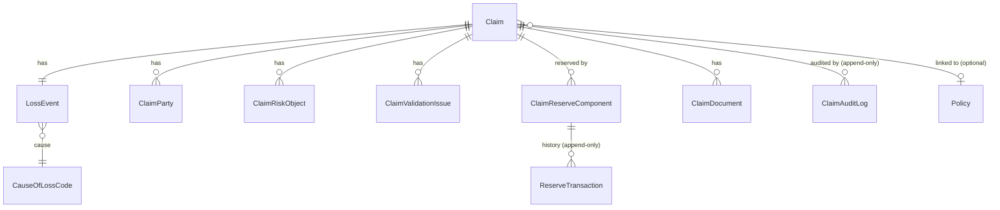
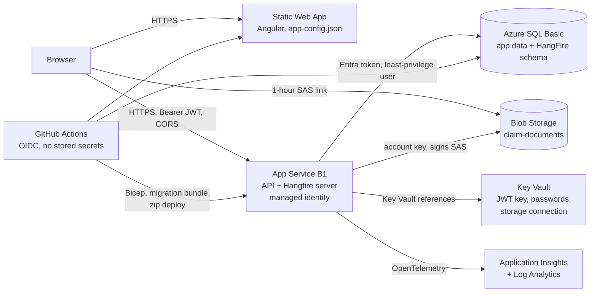

# Architecture

This document explains how the Claims Module is built and **why**. The detailed reasoning behind every choice is in [docs/DECISIONS.md](docs/DECISIONS.md), cited here as **D-nn**. Spec references are **S…** (the functional specification) and **B…** (the assessment brief).

Contents: [Solution structure](#solution-structure) · [Data model](#data-model) · [CQRS flow](#cqrs-flow-a-command-from-api-to-database) · [Domain events](#domain-events) · [Background jobs](#background-jobs-hangfire) · [API conventions](#api-conventions) · [Frontend](#frontend) · [Azure architecture](#azure-architecture) · [Key decisions and tradeoffs](#key-decisions-and-tradeoffs)

---

## Solution structure

Clean Architecture in five projects. Dependencies point inwards only; a reflection-based test (`LayerDependencyTests`) fails the build if, for example, Infrastructure references Persistence.



| Project | Contains | Depends on |
|---|---|---|
| **Domain** | Aggregates `Claim` and `ClaimReserveComponent`, `ClaimDocument`, reference data, value objects (`ClaimNumber`, `Money`), enums, domain events, domain services (`ReserveAuthorityPolicy`, the claim validator, the transition table), `DomainRuleViolationException` | nothing |
| **Application** | One folder per feature (`Claims`, `Reserves`, `Documents`, `Audit`, `ReferenceData`). Each use case is a MediatR command or query with its FluentValidation validator and handler. Pipeline behaviours, DTOs, AutoMapper profiles, and the **abstractions** other layers implement: `IUnitOfWork`, repositories, readers, `IAuditLogService`, `IStorageService`, `IJobScheduler`, `IClaimNumberGenerator`, `ICurrentUser`, `ICorrelationContext`, `TimeProvider` | Domain |
| **Persistence** | `ClaimsDbContext`, one `IEntityTypeConfiguration` per table, conventions, five migrations, `HasData` seed, four `SaveChanges` interceptors, repositories, the Unit of Work, the claim-number generator, the audit-log service, the idempotency store, read-side readers (AsNoTracking + `ProjectTo`) | Application |
| **Infrastructure** | `AzureBlobStorageService` and `LocalFileSystemStorageService`, the Hangfire jobs (thin: each sends a MediatR command) and job filters, `IJobScheduler`, the JWT issuer and the demo user directory | Application (**not** Persistence) |
| **API** | Thin controllers (one MediatR call each), request contracts, the S10.4 error pipeline, JWT authentication, correlation ids, Swagger, the Hangfire server and Basic-auth dashboard, health checks, telemetry; composition root | all |

Jobs live in Infrastructure but contain no logic: they send a command, so the GL posting and the SLA scan run through the same validation, transaction and audit path as an HTTP request, and Infrastructure never needs the database (PLAN §4).

## Data model



| Entity | What it holds | Notes |
|---|---|---|
| **Claim** (aggregate root, RowVer) | Number, status, severity, claim type, policy link, assigned handler, notes, closure and reopen data, SLA flag, reserve-limit override | Owns the lifecycle state machine and its preconditions |
| LossEvent (1:1) | Loss date (UTC), description, location, cause, estimated amount, police report | Separate table, part of the Claim aggregate |
| ClaimParty | Role (Claimant, Insured, ThirdParty, Witness, Attorney), Person/Company, name, contact | Removing = deactivating; the last active Claimant can't be removed (BR-P-01) |
| ClaimRiskObject | Asset type, description, damage, reference, primary flag | One primary per claim |
| ClaimValidationIssue | Code, Critical/Warning, message, field, status (Open, Acknowledged, Waived, Resolved) | Not in the spec's entity list; needed for persisted warnings, waivers and CC-02 (D-05, D-06, D-07) |
| **ClaimReserveComponent** (aggregate root, RowVer) | Indemnity, Expense, ALAE or SubrogationRecoverable; current balance projection; status | At most one per type per claim; one pending change at a time (D-17) |
| ReserveTransaction | Add/Adjust/Reverse, signed amount (the delta), previous and new balance, reason, approval data, posting status, idempotency key `Reserve:{componentId}:Change:{seq}` | **Event-sourced**: never updated except its approval and posting lifecycle fields (D-22) |
| ClaimDocument | Type, name, content type, size, blob path, uploader | Bytes are in Blob Storage, never in the database |
| ClaimAuditLog | Event type, description, old/new JSON, related entity, correlation id, user, time | **Append-only**: an EF interceptor, a database trigger and a `DENY UPDATE, DELETE` on the app's database role (D-23, D-57, D-62) |
| Policy, CauseOfLossCode | Simulated policies and the cause codes | Seeded; a policy's Active/Expired status is computed from dates (D-34) |
| ClaimStatusTransition | (From, To, required role, requires reason) | The allowed transitions as data; checked against the table and the domain (D-08, D-59) |
| ClaimNumberSequence | (Organisation, Year) → next number | Gapless numbering (D-14) |
| IdempotencyRecord | (Organisation, User, Key) → command type, payload hash, stored result | Idempotency-Key replay (D-66) |

**Conventions (S15):** sequential GUID keys generated in the domain (`ValueGeneratedNever`, with `NEWSEQUENTIALID()` as the column default), `DECIMAL(19,4)` money, `DATETIMEOFFSET` in UTC, enums stored as strings, `OrganisationId` and audit columns (`CreatedAt`, `UserCreated`, `UpdatedAt`, `UserModified`) as **shadow properties** set by interceptors, soft delete (`IsDeleted`, `DeletedAt`), and **global query filters** for soft delete and tenant on every business table. Fluent API only; no data annotations in the domain.

**Two aggregates, one consistency boundary.** Reserves are their own aggregate (many transactions, separate concurrency), but some rules span both: the $10M aggregate limit, "no pending approvals before closing" (CC-01), and "an approved reserve before PendingPayment". Every reserve command therefore also **touches the Claim root** (it sets `LastReserveActivityAt`, which bumps the Claim's RowVer), so a reserve change and a concurrent claim change conflict with a 409 instead of both succeeding on stale facts (PLAN §3, D-68).

## CQRS flow: a command from API to database

Every write is a **command** and every read a **query**, both sent through MediatR. Example: a supervisor approves a reserve change.

```mermaid
sequenceDiagram
  participant C as ReservesController
  participant M as MediatR pipeline
  participant H as ApproveReserveHandler
  participant D as Domain (aggregates)
  participant U as Unit of Work
  participant DB as Azure SQL
  participant J as Hangfire
  C->>M: Send(ApproveReserveCommand)
  Note over M: Logging → Authorization → Validation → Transaction → Idempotency
  M->>H: Handle
  H->>D: load Claim + component, component.Approve(actor, limits)
  D-->>H: raises ReserveTransactionApproved
  H->>U: SaveChanges
  U->>U: dispatch BeforeCommit events (audit entry RESERVE_APPROVED)
  U->>DB: INSERT/UPDATE (interceptors stamp tenant, audit, soft delete; RowVer checked)
  U->>DB: COMMIT
  U->>J: dispatch AfterCommit events (enqueue PostGlReserveChangeJob)
  M-->>C: ReserveTransactionStateDto → 200
```

1. **Controller.** Binds the request contract (separate from the command, D-72), adds the route ids and the `Idempotency-Key`, and sends one command. No logic.
2. **Pipeline behaviours** (`Application/Common/Behaviours`), in this order:
   - **Logging:** request name, duration and outcome, structured (Serilog).
   - **Authorization:** `[RequiresRole(Supervisor)]` on the command, checked against the JWT's role. Role rules live only here, not as ASP.NET policies, so HTTP, jobs and tests share one rule set (D-72). Jobs carry `[SystemRequest]`.
   - **Validation:** every FluentValidation validator of the command; failures become a 422 with field-level messages and rule codes. This layer covers the **request** (formats, required fields, the future loss date, the description length, an active cause code). Rules about the **claim's state** are persisted as validation issues instead, so a claim can be created as a Draft with problems to fix (D-05).
   - **Transaction:** the Unit of Work opens a transaction inside EF's retrying execution strategy, so a transient Azure SQL error replays the whole command (D-56).
   - **Idempotency:** with an `Idempotency-Key`, the result is stored **in the same transaction** as the change; a repeat with the same key and payload replays it, a different payload is a 409 (D-66).
3. **Handler.** Loads aggregates through repositories, calls **domain methods**, which enforce the invariants and raise domain events. For example, `Approve` checks the approver's authority for |delta| (≤ $10k auto, ≤ $100k supervisor, above that manager), forbids self-approval, and re-checks the $10M limit at approval time (D-19, D-24).
4. **Unit of Work** (`Persistence/UnitOfWork.cs`): dispatch `BeforeCommit` events (audit entries are added to the same context), `SaveChanges` (interceptors: append-only guard → soft delete → tenant → audit columns), commit, then dispatch `AfterCommit` events (job enqueueing). A RowVer conflict becomes a 409; a lost after-commit enqueue is logged, never rolled back, and recovered by the sweep job.

**Reads** go through readers in Persistence (`ClaimReader`, `ReferenceDataReader`) using `AsNoTracking` and AutoMapper `ProjectTo` straight into DTOs. They never load the domain model, so list and detail queries are single SQL statements and can't change state by accident. AutoMapper profiles live in Application (`ClaimsProfile`, `ReferenceDataProfile`) and a test calls `AssertConfigurationIsValid`.

## Domain events

Aggregates collect events while they change (`AggregateRoot.Raise`). The Unit of Work publishes each one twice through MediatR, wrapped as `BeforeCommit<T>` and `AfterCommit<T>`, so handlers are ordinary typed notification handlers and choose their phase:

- **Before commit, same transaction:** `AuditTrailHandlers` writes the audit entry. The audit log therefore can't miss a change or record one that rolled back (S14.2).
- **After commit:** job enqueueing. A job never runs for a change that didn't commit.

| Domain event (raised by) | Before commit: audit entry | After commit |
|---|---|---|
| `ClaimCreated` (Claim) | CLAIM_CREATED | |
| `ClaimStatusChanged` | STATUS_CHANGED | |
| `ClaimClosed`, `ClaimReopened` | CLAIM_CLOSED, CLAIM_REOPENED (plus STATUS_CHANGED) | |
| `ClaimPartyAdded`, `ClaimPartyRemoved` | PARTY_ADDED, PARTY_REMOVED | |
| `ValidationIssueRaised` | VALIDATION_ISSUE_ADDED | |
| `ValidationIssueWaived`, `ValidationWarningsAcknowledged` | VALIDATION_ISSUE_WAIVED, WARNINGS_ACKNOWLEDGED | |
| `ClaimPolicyLinked`, `ClaimHandlerAssigned` | POLICY_LINKED, HANDLER_ASSIGNED | |
| `ClaimLossDetailsUpdated`, `ClaimNotesUpdated`, `ClaimSeverityChanged`, `ClaimRiskObjectAdded/Removed` | CLAIM_UPDATED | |
| `ReserveLimitOverrideChanged` | RESERVE_LIMIT_OVERRIDE_SET | |
| `ClaimSlaBreachDetected` (SLA job) | SLA_BREACH_DETECTED | |
| `ReserveTransactionSubmitted` (ClaimReserveComponent) | RESERVE_CREATED | |
| `ReserveTransactionApproved` | RESERVE_AUTO_APPROVED or RESERVE_APPROVED | **enqueue the GL posting job** |
| `ReserveTransactionRejected`, `…Retracted` | RESERVE_REJECTED (with the reason), RESERVE_RETRACTED | |
| `ReservePostingCompleted` (GL job) | GL_POSTING_SIMULATED with a DR/CR journal | |
| `ReservePostingFailed` (final-failure filter) | GL_POSTING_FAILED | |
| `ReservePostingRetryRequested` (supervisor retry) | GL_POSTING_RETRY_REQUESTED | **enqueue the GL posting job** |
| `ReservePostingRequeued` (sweep) | | **enqueue the GL posting job** |
| `ClaimDocumentUploaded` | DOCUMENT_UPLOADED | |

All 16 event types of S14.1 are written, plus a few additions the extra operations need (D-31). Every entry carries the request's correlation id.

## Background jobs (Hangfire)

Hangfire runs inside the API process (SQL Server storage in the `HangFire` schema of the same database). The jobs are thin classes in Infrastructure that send a MediatR command, so all logic is in Application.

| Job | Trigger | What it does |
|---|---|---|
| **PostGlReserveChangeJob** | Enqueued **after commit** when a reserve change is approved (auto or manual), when a supervisor retries a Failed posting, or by the sweep | `SimulateGlPostingCommand`: marks the transaction Posted with the job id and writes GL_POSTING_SIMULATED with a debit/credit journal (S12.1) |
| **SlaMonitoringJob** | Recurring, `*/15 * * * *` | Draft/Open claims with no activity for 48 hours get `IsSlaBreached` and SLA_BREACH_DETECTED, at most once per 24 hours per claim. The status doesn't change (S12.2, D-13) |
| **StalePostingSweepJob** | Recurring, `*/5 * * * *` | Approved transactions still Pending after `GlPosting:StalePendingAfter` (10 min) are re-enqueued. This covers the dual-write gap: the commit succeeded but the enqueue was lost (D-56) |

**Idempotency of the GL posting.** One reserve change must produce exactly one ledger posting, whatever happens to the job:

- **One key per change.** Each transaction gets the key `Reserve:{componentId}:Change:{sequence}` when it is created (unique index), and every enqueue for that change carries it.
- **Re-entrant handler.** It reloads the component and does nothing if the transaction is already Posted. A Hangfire retry, a sweep re-enqueue or a duplicate enqueue is therefore a no-op.
- **Concurrent runs.** Posting changes the component, so its RowVer changes. Of two simultaneous runs, the second fails with a concurrency error, and its retry then finds Posted. A test runs the job twice in a row and three times concurrently, and asserts exactly one GL_POSTING_SIMULATED each time.
- **Retries and final failure.** Hangfire retries 3 times (10/30/60 s). A process-global `IApplyStateFilter` sees the job reach Failed and sends `MarkGlPostingFailedCommand`, which sets the transaction to Failed and writes GL_POSTING_FAILED. A supervisor can retry a Failed posting (D-28). `GlPosting:SimulatedFailureRate` makes the simulated GL call fail, to demonstrate this.
- **Telemetry.** Each job run is an OpenTelemetry activity, so App Insights shows job runs with their SQL calls. Hangfire's own polling queries are filtered out (D-71).

The dashboard (`/hangfire`) is protected by HTTP Basic auth with the password from Key Vault. A browser can't send a Bearer token when it navigates to a page, so JWT is not an option. If no password is configured, the dashboard isn't mapped at all (D-41).

## API conventions

- **REST + JSON**, kebab-case routes, enums as names. Swagger documents every endpoint with Bearer auth and the Idempotency-Key header.
- **One error shape** for every failure (S10.4 plus `codes`, `detail`, `correlationId`, as `application/problem+json`):

  | Status | Meaning |
  |---|---|
  | 400 | Unparsable JSON |
  | 401 | No or invalid token |
  | 403 | Role, or a domain "not allowed" (e.g. a handler approving) |
  | 404 | Not found |
  | 409 | Concurrency or idempotency conflict |
  | 422 | Validation, business rule, type or enum mismatch; field-level `errors` and rule `codes` |
  | 429 | Sign-in rate limit |
  | 500 | Unexpected; no details, only the correlation id |

  Handled 4xx are logged at Information, not as errors (D-72).
- **Authentication:** mock users with a real HS256 JWT (`sub`, `name`, `role`, `org`) from `POST /api/auth/token`. A fallback policy requires an authenticated user everywhere except sign-in, the user directory, health and Swagger. Sign-in is rate-limited.
- **Correlation:** an `X-Correlation-Id` header is accepted or generated, echoed back, written to every log line and audit entry.

## Frontend

Angular 22 with standalone components and **lazy routes** for the claims list, FNOL and claim detail (D-37). It uses Material with a custom palette and reactive forms throughout.

- **Typed service layer:** `ClaimsApiService` and `AuthService`. Components never call `HttpClient` directly (S11).
- **Interceptors:**

  | Interceptor | Does |
  |---|---|
  | Auth | Adds the Bearer token. A 401 sends the user back to sign-in. |
  | Idempotency | Adds a GUID `Idempotency-Key` to every write, and retries a network failure once with the same key. |
  | Loading | Drives the progress bar. |
  | Error | Shows a snackbar built from the error body. Forms opt out and show errors inline. |

- **Sign-in (D-73):** a form with a user picker and a password field; there are no passwords in code or configuration. Tokens are kept in memory for the tab, never in localStorage. The role switcher re-uses a token issued earlier in the tab, otherwise it asks for the password. The user list has explicit loading and error states (D-75).
- The UI **mirrors** server rules only to guide the user: the authority indicator, the future-date check, the upload allowlist. The server always decides.

## Azure architecture



- **The API** runs on App Service B1 with Always On (the Free tier sleeps, which would stop the recurring jobs). It authenticates to Azure SQL with its **managed identity** as a contained user with a least-privilege role: data access only on the application schema (no DDL on `dbo`; DDL only inside Hangfire's own schema, which Hangfire installs at start-up) and `DENY UPDATE, DELETE` on the audit log (D-62). Azure SQL accepts **Entra authentication only**, so there is no SQL password anywhere (D-60).
- **Secrets** (JWT key, storage connection string, dashboard and demo passwords) are Key Vault secrets, read by App Service through **Key Vault references** using the managed identity (*Key Vault Secrets User*). The deploy pipeline fails if any reference doesn't resolve (D-70).
- **Documents:** uploads go through the API, which validates size, extension and MIME type and writes the blob. **Downloads don't**: the API returns a read-only SAS link for one blob, valid for 1 hour, and the browser fetches directly from Blob Storage (BR-D-02).
- **The frontend** is a Static Web App. The deploy writes `app-config.json` with the API URL, so the same build works everywhere (D-61). The API's CORS allows only that origin.
- **Telemetry:** Azure Monitor OpenTelemetry sends requests, dependencies, logs and job activities. A filter drops Hangfire's polling SQL to keep ingestion small (D-71).
- **CI/CD:** GitHub Actions with OIDC federation, so there are no Azure credentials in GitHub. Bicep defines all resources, and the migrations run as an EF bundle. The deploy waits until `/health/live` reports the new commit before it runs the smoke test (D-69).

## Key decisions and tradeoffs

The full register is [docs/DECISIONS.md](docs/DECISIONS.md). These are the decisions most worth knowing, and the ones a reviewer is most likely to ask about.

| Topic | Decision | Why / tradeoff |
|---|---|---|
| **Precedence** (D-00) | The spec wins on business rules, the brief on stack and delivery; real conflicts are listed and resolved | The two documents disagree in places: reserve component names, the SLA "status", the meaning of BR-C-06. Every conflict has an entry. |
| **Two layers of validation** (D-05) | Request rules → 422, nothing saved. Claim-state rules → persisted validation issues; a claim can be a Draft with problems | S5.4 wants claims saved with Critical issues, while S8 and S10.4 want 422s. Splitting by *request* vs *state* satisfies both. |
| **Gapless claim numbers** (D-14) | A `(Org, Year)` counter row updated with `MERGE … HOLDLOCK` inside the FNOL transaction | A SQL `SEQUENCE` leaves gaps on rollback; the spec says "no gaps". The cost is serialised claim creation per organisation, which is fine at this volume. Proven by tests, including lock-level ones (`sys.dm_tran_locks`). |
| **Adjust = target balance** (D-16) | Add opens with an amount, Adjust sets a new balance, Reverse goes to zero; the server stores the signed delta; authority uses \|delta\| | Keeps BR-R-01 ("amount > 0") literally true while allowing decreases. A large reduction needs approval just like a large increase. |
| **Gross $10M limit, checked twice** (D-19) | Indemnity + Expense + ALAE; Subrogation excluded; checked at submission and again at approval | Expected recoveries are uncertain and shouldn't offset exposure. The approval-time re-check covers other approvals that land meanwhile. This deliberately deviates from "across all components". |
| **Event-sourced reserves** (D-22) | INSERT a transaction per change, never UPDATE an amount. Only approval and posting status change on a row | The history is the source of truth. The balance is a projection kept in the same transaction. |
| **Audit atomicity vs jobs** | Audit entries are written *before* commit in the same transaction; jobs are enqueued *after* commit; a sweep repairs a lost enqueue | Avoids distributed transactions. The audit log is exactly consistent with the data, and jobs never run for rolled-back changes. Cost: a sweep job and a short delay in the rare lost-enqueue case. |
| **Cross-aggregate concurrency** (D-68) | Reserve commands touch the Claim root's RowVer | Two aggregates, one invariant: conflicts surface as 409s instead of silent races. |
| **Append-only audit, three ways** (D-23, D-62) | EF interceptor + database trigger + `DENY` on the app role | Defence in depth: a bug, a raw SQL statement or a compromised app credential still can't rewrite history. |
| **Idempotency inside the transaction** (D-66) | The stored result commits with the change | An HTTP middleware can't join the command's transaction, so "done but not recorded" would be possible. |
| **Roles only in the MediatR pipeline** (D-72) | No duplicate ASP.NET role policies | Jobs and tests go through MediatR too, so a single rule set can't drift. Finer rules (amount authority, self-approval) stay in the domain. |
| **Hangfire dashboard: Basic auth** (D-41) | Credentials from Key Vault; not mapped without a password | A browser can't send a Bearer token on navigation. Basic over HTTPS is simple and enough here. |
| **Passwordless Azure** (D-60, D-63) | Entra-only SQL, managed identity, Key Vault references, GitHub OIDC | No database password exists anywhere; the pipeline has no stored Azure secret. |
| **Pinned OSS versions** (D-38, D-67) | MediatR 12.x, AutoMapper 14.x (the last open-source releases) | Newer versions are commercial. AutoMapper 14 has known advisories, assessed in D-67: our maps are flat and fed only by trusted data. |
| **.NET 9 past end of support** | Kept because the brief mandates it | Recorded as a risk; the upgrade path is .NET 10 LTS (retarget, then update EF/ASP.NET packages). |
| **Demo sign-in** (D-73, the engineer's decision) | Form only; tokens in memory; passwords rotated and handed over with the submission | Any password in the frontend bundle would be public. |

### Deliberate deviations from the literal spec

Listed in [DECISIONS.md](docs/DECISIONS.md#deliberate-deviations-from-the-literal-spec-summary):
- the gross aggregate limit (D-19);
- no soft-delete or UpdatedAt columns on the immutable audit log (D-23);
- a `{documentId}-` prefix on blob names so uploads never overwrite each other (D-29);
- 422 for Critical request errors instead of a Draft claim (D-05);
- 403 instead of 422 for a missing role (D-24);
- infrastructure tables without the full audit column set (D-51).
